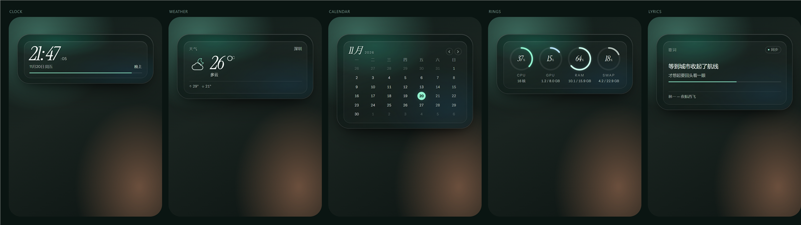

# 组件视觉规范

这份文档把 `widgets/` 里五个官方组件已经采用的视觉语言固定下来。目的只有一个：新的组件
（以及后续同步到 Sill 内置卡的改动）不用每次重新发明字号、间距、状态写法，放在一起也不会
互相打架。



组件只画卡片**内容**；玻璃、圆角、卡片内距（13/14px，≥600px 时 15/16px）由宿主的 `.card`
提供。下面的规范都在这个前提里工作。

## 1. 卡片解剖

一张卡最多四层，从上到下：

| 层 | 内容 | 写法 |
|---|---|---|
| 眉标 | 卡片身份、城市、状态 | `.xx__cap`：10px / `.17em` / 大写 / `--ink-faint` |
| 主值 | 时间、温度、月份、当前歌词 | 衬线斜体（见 §2） |
| 次要信息 | 日期、描述、高低温、`已用 / 总量` | 11–13px / `--ink-dim` 或 `--ink-soft` |
| 底栏 | 高低温、缓存时间、进度的落点 | 1px 分隔线 `rgba(255,255,255,.08)` + 10–12px |

- 眉标与底栏不是每张卡都必须有，但**每张卡最多一个眉标、一条分隔线**；
- 主值一张卡只有一个（Rings 是四个并列的主值，属于列表型卡片）；
- 状态徽标放在右上角，与眉标同一行；不要另起一行。

## 2. 字号与字体

| 角色 | 字体 | 字号 | 其它 |
|---|---|---|---|
| 主数字（时间、温度、月份、环里的百分比） | `--serif` 斜体 | `clamp(24px, …cqw, 156px)` | `line-height .8–.95`、`letter-spacing -.02 ~ -.035em` |
| 正文（歌词当前行、卡片主文） | `--sans` 500 | `clamp(15px, 4.9cqw, 19px)` | `line-height 1.42` |
| 次要信息 | `--sans` | 12.5px（`--ink-dim`） | `line-height 1.45` |
| 说明 / 注释 | `--sans` | 10.5–11px（`--ink-dim` / `--ink-faint`） | 中文不低于 10.5px |
| 眉标 / 徽标 | `--sans` | 9.5–10px，`.14–.17em` | 中文不加 `text-transform` 也不会出错 |

数字一律 `font-variant-numeric: lining-nums tabular-nums`；中文与数字混排时不要改
`letter-spacing` 正负号来回切，统一 `.01–.02em`。

> 衬线斜体是 Sill 的语气（头图时钟就是这个写法）。官方组件只在**一个**元素上用它：
> 让视线先落在主值上，而不是满卡斜体。

## 3. 颜色

只用主题变量，不写死色相：

- 文字四级：`--ink` / `--ink-soft` / `--ink-dim` / `--ink-faint`；
- 强调：`--accent`；需要第二、第三档时用 `--accent-2` / `--accent-pale`，不要新发明色相；
- 强调色的浅底：`--accent-soft`；发光：`--accent-glow`；实心强调上的文字：`--accent-ink`；
- 分隔线与轨道：`rgba(255,255,255,.07–.12)`；
- 辅助/弱语义（例如 SWAP）：`--ink-dim`，不抢强调色。

需要调色时用 `color-mix(in oklab, var(--accent) 38%, transparent)` 这类**同一色相**的混合，
不要出现 `hsl(215 …)` / `hsl(36 …)` 这种与主题无关的固定色。旧版 Rings 的蓝 / 琥珀 / 粉
就是因为写死了色相，换 Ember 主题时整套不协调。

## 4. 间距与圆角

- 卡片内节奏用 2 / 4 / 6 / 8 / 9 / 10 / 12 / 14px，不要出现 13 / 17 / 23 这类奇数值；
- 组与组之间 8–10px；同一个组内的行距 2–6px；
- 卡片圆角由宿主提供，组件内部控件用 7–12px，胶囊用 `999px`；
- 圆环、今天的高亮圆点用 `border-radius: 50%` + `aspect-ratio: 1`，不要在非正方形格子上用
  50%（会变成椭圆）。

## 5. 响应式

所有组件都在 `:host` 上声明 `container-type: inline-size`，用 **容器宽度**判断，不看窗口。

| 内容宽 | 典型来源 | 布局 |
|---|---|---|
| < 200px | 自由布局拖窄的卡 | 只保留主值与最关键的一行；隐藏年份、副标题、秒数等次要信息 |
| 200–300px | 3 列面板的单跨（185–253） | 单列紧凑；Rings 可以 2×2 |
| 300–520px | 默认 rail（318）、2 列（273/340） | 单列标准排版 |
| ≥ 520px | 跨 2–3 列（660/1110） | **换排版，不拉伸**：左右分栏、限宽居中、或把主值放大 |

三条硬规则：

1. 主值字号用 `clamp(最小, …cqw, 最大)`，到宽卡有上限，不能把时钟拉成一面墙；
2. 宽卡要重新组织信息（Clock 左右分栏、Calendar 月块 + 网格、Lyrics 限宽 720px 居中），
   不能只是把 318px 的排版横向拉长；
3. 185px 与 150px 下不横向溢出；测完再看 1110px 下有没有把内容拉成一条细线。

## 6. 交互状态

| 状态 | 表现 |
|---|---|
| hover | 背景 `--accent-soft` 或颜色提亮，160ms `--ease-out` |
| active | `transform: scale(.94–.97)`，120ms |
| focus-visible | `outline: 1.5px solid var(--accent); outline-offset: 2px` |
| disabled / 无数据 | 降到 `--ink-faint`，不隐藏结构（高度不跳） |
| loading | 骨架条或整体降透明度；不要用转圈 |
| empty / error | 一句状态 + 一句提示 + 可选「重试」胶囊 |

- 只给**真的能点**的元素加 hover 与 `cursor: pointer`；纯展示的日期格、圆环不加假交互；
- 动效 160–260ms；`prefers-reduced-motion: reduce` 时关掉动画与位移；
- 状态文案走 `widget.json` 的 `strings`，用 `data-sill-i18n` 静态节点 + JS 切换 `hidden` /
  `data-state`，不要在 JS 里写第二套文案。

## 7. 状态机写法

官方组件统一用两种模式之一：

```html
<!-- A. CSS 状态：徽标文本只显示与 data-state 匹配的那一条 -->
<span class="badge" data-state="synced">
  <span data-state="synced" data-sill-i18n="synced">同步</span>
  <span data-state="loading" data-sill-i18n="loading">搜索中</span>
</span>
```

```js
// B. JS 切换整个块：块本身在 HTML 里，文案在 strings 里
const BLOCKS = { synced: 'stage', loading: 'loading', idle: 'idle', error: 'error' }
for (const id of Object.values(BLOCKS)) root.getElementById(id).hidden = true
root.getElementById(BLOCKS[state]).hidden = false
```

两种都比「JS 里拼中文」好：语言切换由宿主重写节点，热重载不会丢文案。

## 8. 数据格式化

- `Number(null)` 是 `0`，不是「没有数据」：先 `typeof value === 'number' && Number.isFinite(value)`；
- 百分比在组件里四舍五入成整数，避免 `34.2%` 这种噪声；一个数只保留组件真正需要的小数位；
- 同一张卡里同类数字的小数位保持一致（`1.2 / 8.0 GB`，不是 `1.2 / 8 GB`）；
- 时间、日期自己排成卡片需要的短格式（`11月20日 周五` / `Fri 20 Nov`），不要让宿主的长格式
  撑破 185px；
- 缺数据用 `—`，不要用 `0`、空字符串或隐藏整块（除了确实没有意义的行，例如没有高低温时的底栏）。

## 9. 无障碍

- 中文最小 10.5px，英文/数字最小 9px；眉标不承担关键信息；
- 交互元素必须是真实 `<button>` / `<a>`，有可访问名（可见文字或 `.sr` 里的 i18n 文本）；
- 纯展示的复合卡片给一个汇总 `aria-label`（例如日历的「2026年11月 · 11月20日 周五」），
  内部装饰 `aria-hidden`；
- 进度条 / 圆环用数字文本配合，颜色不是唯一状态表达；
- `prefers-reduced-motion` 之外，不要自动播放循环动画（呼吸圆点除外，且要能关）。

## 10. 发布前自检

- [ ] `:host` 有 `container-type: inline-size`
- [ ] 185 / 150 / 318 / 660 / 1110px 都截图看过，无溢出、无孤行、无拉伸
- [ ] 中英各看一遍，最小字号达标
- [ ] Ember / Dusk 各看一遍，没有写死颜色
- [ ] hover / active / focus-visible / loading / empty / error 都有定义
- [ ] `main.js` 的定时器、请求、监听在 `onDispose` 里清理
- [ ] `widget.json` 的 `strings` 与实际用到的 key 一一对应，没有死键
- [ ] 数据为 `null` 时显示 `—`，不显示 `0`
- [ ] `python scripts/validate.py widgets/<id>` 通过
